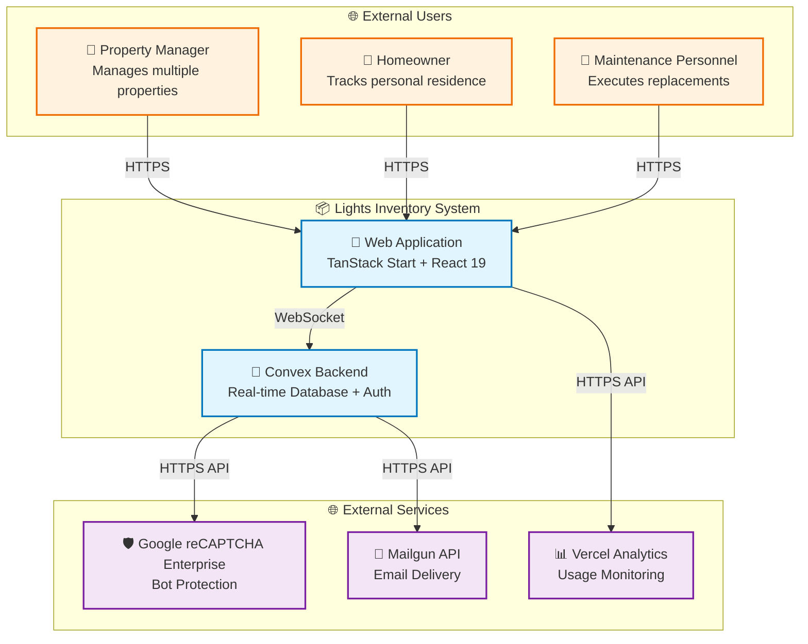
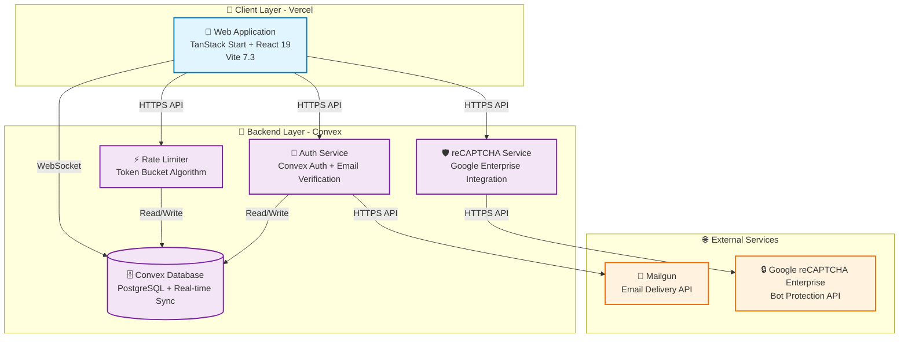
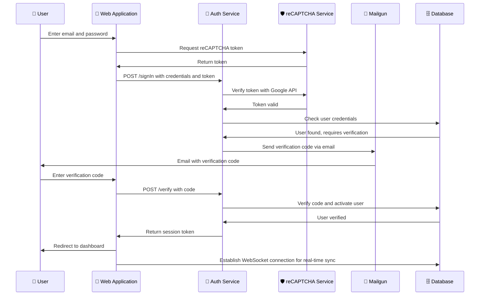
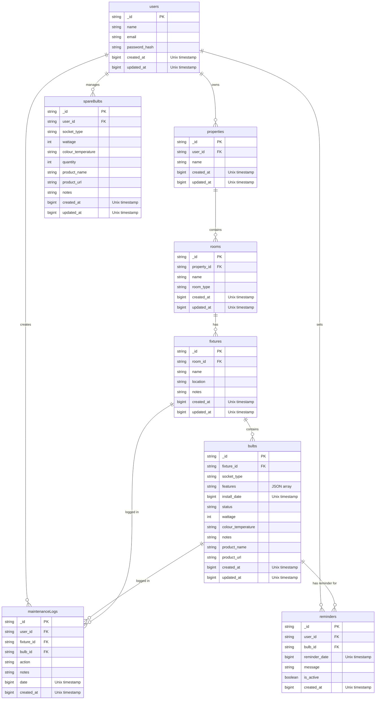

# Lights Inventory Architecture Brief

> Historical snapshot from before the static-SPA remediation. Routing, build/deployment details and version tables below are not current implementation guidance. See the root README and AGENTS.md for the maintained architecture and verification workflow.

## Table of Contents

- [Overview](#overview)
- [Problem Definitions & Business Context](#problem-definitions--business-context)
  - [Problem Statement](#problem-statement)
  - [Business Context](#business-context)
- [C4 System Context Diagram](#c4-system-context-diagram)
- [System Overview](#system-overview)
  - [C4 Container Diagram](#c4-container-diagram)
  - [C4 Container Diagram Explanation](#c4-container-diagram-explanation)
  - [Request Flow Sequence](#request-flow-sequence)
  - [Technology Stack](#technology-stack)
- [System Data Models](#system-data-models)
  - [Data Model ER Diagram](#data-model-er-diagram)
  - [Data Model Explanation](#data-model-explanation)
- [API Endpoints](#api-endpoints)
  - [Core API Routes](#core-api-routes)
  - [Convex Backend Functions](#convex-backend-functions)
- [Deployment Architecture](#deployment-architecture)
- [Document Metadata](#document-metadata)
## Overview

Lights Inventory is a web-based inventory management system designed for property managers and homeowners to track and manage light fixtures and bulbs across multiple properties. The system provides a centralized interface for cataloging light fixtures by room and property, tracking bulb installation dates, monitoring bulb status (working, flickering, dead), managing spare bulb inventory, and setting maintenance reminders.

The application is built as a full-stack web application using modern frontend technologies with Convex as the backend-as-a-service platform. It features real-time data synchronization, authentication with email verification, and responsive design optimized for both desktop and mobile use.

Primary users include:

- Property managers managing multiple residential or commercial properties
- Homeowners tracking lighting inventory for personal residences
- Maintenance personnel responsible for lighting upkeep
- Property owners seeking to optimize bulb replacement schedules

The system addresses the challenge of maintaining accurate records of lighting infrastructure across distributed properties, enabling proactive maintenance and reducing downtime due to unexpected bulb failures.

## Problem Definitions & Business Context

> **This section is the foundation of the architecture brief.** It grounds all subsequent technical decisions by establishing _why_ the system exists and _what_ problems it solves. Readers should understand the business motivation before diving into technical implementation details.

### Problem Statement

Prior to Lights Inventory, property managers and homeowners faced several significant challenges in managing lighting infrastructure:

1. **Lack of Centralized Tracking**: Light fixture and bulb information was often scattered across spreadsheets, notes, or mental records, making it difficult to know what bulbs were installed where, when they were installed, and their current status.

2. **Reactive Maintenance**: Without proactive tracking, bulb failures were discovered only when lights stopped working, leading to inconvenient outages and emergency maintenance requests. There was no systematic way to anticipate bulb replacements based on installation dates or usage patterns.

3. **Inefficient Inventory Management**: Spare bulbs were often overstocked or understocked across properties. Without visibility into inventory levels, purchasing decisions were made reactively rather than strategically, leading to wasted resources or delays during replacements.

4. **Property-Specific Requirements**: Different properties had different lighting requirements (socket types, color temperatures, wattages). Without a system to track these specifications, maintenance personnel often brought incorrect replacement bulbs, requiring multiple trips.

5. **No Historical Data**: Without records of bulb lifespans and failure patterns, there was no data to inform purchasing decisions or identify problematic fixtures or bulb brands.

The system was designed to address these pain points by providing a centralized, accessible platform for tracking all lighting infrastructure with features for proactive maintenance reminders, inventory optimization, and historical analysis.

### Business Context

**Primary Users:**

- Property Managers: Responsible for maintaining lighting across multiple properties, need visibility into bulb status and inventory levels
- Homeowners: Track lighting in personal residences, want reminders for bulb replacement
- Maintenance Personnel: Execute bulb replacements, need accurate fixture specifications and spare bulb locations
- Property Owners: Make strategic decisions about lighting investments and maintenance budgets

**Use Cases:**

- Catalog all light fixtures by property, room, and location (ceiling, wall, floor, etc.)
- Track bulb installation dates, specifications (socket type, wattage, color temperature), and status
- Set and receive maintenance reminders for bulb replacements
- Manage spare bulb inventory across properties
- Search and filter bulbs by status, property, room, or specifications
- Import/export inventory data for backup and reporting
- Bulk update bulb status during maintenance operations

**Non-Functional Requirements:**

- **Availability**: System should be available 24/7 for maintenance personnel in the field
- **Performance**: Dashboard and search queries should load within 2 seconds
- **Security**: User authentication with email verification, data isolated by user
- **Scalability**: Support hundreds of properties and thousands of fixtures per user
- **Mobile Responsiveness**: Full functionality on mobile devices for field use
- **Data Integrity**: Prevent data loss with automatic synchronization and conflict resolution

**Integration Points:**

- Google reCAPTCHA Enterprise: Bot protection for authentication (HTTPS API)
- Mailgun API: Email delivery for verification codes and notifications (HTTPS API)
- Convex Platform: Backend-as-a-service for data storage and real-time sync (WebSocket)
- Vercel Analytics: Usage analytics and performance monitoring (HTTPS API)
## C4 System Context Diagram

**System Context Explanation:**

The Lights Inventory System serves three primary user types who interact through a web application. Property managers, homeowners, and maintenance personnel access the system via HTTPS to perform inventory management tasks. The web application communicates with the Convex backend via WebSocket for real-time data synchronization. The backend integrates with three external services: Google reCAPTCHA Enterprise for authentication security, Mailgun for email delivery (verification codes and notifications), and Vercel Analytics for usage monitoring. All external integrations use HTTPS APIs.

## System Overview

### C4 Container Diagram

### C4 Container Diagram Explanation

The system is deployed across two primary platforms: Vercel for the frontend web application and Convex for the backend services.

**Client Layer (Vercel):**

- **Web Application**: Built with TanStack Start framework using React 19 and Vite 7.3. This SPA (Single Page Application) handles all user interactions, routing, and state management. It communicates with Convex via WebSocket for real-time data synchronization and via HTTPS API for server-side operations.

**Backend Layer (Convex):**

- **Auth Service**: Manages user authentication using Convex Auth with password-based authentication and email verification. Handles user registration, login, session management, and password reset flows.
- **Database**: Convex's managed PostgreSQL database with real-time synchronization capabilities. Stores all user data with automatic conflict resolution and offline support.
- **Rate Limiter**: Implements token bucket algorithm to prevent abuse of sensitive operations like authentication and bulk updates. Stores rate limit state in the database.
- **reCAPTCHA Service**: Integrates with Google reCAPTCHA Enterprise to provide bot protection during authentication and other sensitive operations.

**External Services:**

- **Mailgun**: Used by the Auth Service to send verification codes and notification emails via HTTPS API.
- **Google reCAPTCHA Enterprise**: Used by the reCAPTCHA Service for token verification and risk assessment via HTTPS API.

### Request Flow Sequence

The most critical use case is **User Login with Email Verification**:

### Technology Stack

**Runtime & Languages:**

- TypeScript 5.7.2 (strict mode enabled)
- Node.js 20 (Vercel runtime)
- React 19.2.0 (UI framework)
- TanStack Start 1.168.60 (full-stack framework with file-based routing)
- TanStack Router 1.168.2 (client-side routing)
- Vite 7.3.1 (build tool and dev server)

**Data Storage:**

- Convex Database 1.34.0 (managed PostgreSQL with real-time sync)
- Convex Auth 0.0.91 (authentication service)
- Convex Query 0.1.0 (React Query integration for data fetching)

**Infrastructure:**

- Vercel (frontend hosting and deployment)
- Convex Platform (backend hosting and database)
- Nitro 4.0.0 (server-side rendering and API routes)
- pnpm 10.x (package manager)

**Monitoring & Security:**

- Vercel Analytics 2.0.1 (usage analytics and performance monitoring)
- Google reCAPTCHA Enterprise (bot protection)
- Biome 2.4.10 (linting and code quality)
- Vitest 3.0.5 (unit testing)

**UI/Styling:**

- Tailwind CSS 4.1.18 (utility-first CSS framework)
- Radix UI 1.4.3 (headless UI component library)
- shadcn/ui (component library built on Radix UI)
- Lucide React 0.577.0 (icon library)
- Sonner 2.0.7 (toast notifications)
- next-themes 0.4.6 (theme management)
## System Data Models

### Data Model ER Diagram

### Data Model Explanation

The data model follows a hierarchical structure that mirrors the physical organization of lighting infrastructure: Users own Properties, Properties contain Rooms, Rooms contain Fixtures, and Fixtures contain Bulbs.

**Core Entity Relationships:**

1. **Users to Properties**: One-to-many relationship. Each user can manage multiple properties, enabling property managers to track lighting across their entire portfolio while maintaining data isolation between users.

2. **Properties to Rooms**: One-to-many relationship. Each property contains multiple rooms, allowing granular tracking of lighting by physical space within a property.

3. **Rooms to Fixtures**: One-to-many relationship. Each room can have multiple light fixtures at different locations (ceiling, wall, floor, table, etc.).

4. **Fixtures to Bulbs**: One-to-many relationship. Each fixture can contain multiple bulbs (e.g., multi-bulb chandeliers or track lighting).

**Supporting Entities:**

5. **Spare Bulbs**: One-to-many relationship with Users. Represents inventory of replacement bulbs not currently installed in fixtures, indexed by socket type, wattage, and color temperature for easy matching with installed bulbs.

6. **Maintenance Logs**: Many-to-one relationships with Users, Fixtures, and Bulbs. Records all maintenance actions performed, creating an audit trail for compliance and historical analysis.

7. **Reminders**: Many-to-one relationships with Users and Bulbs. Stores scheduled reminders for bulb replacement based on installation dates or custom schedules.

**Data Storage Formats:**

- All entities use Convex's automatic schema validation with TypeScript types
- Array fields (e.g., bulb features) are stored as JSON arrays in the database
- Date/time fields are stored as Unix timestamps (number type) for efficient querying
- Enum fields (room_type, location, socket_type, status, colour_temperature) use union types for type safety

**Data Flow Patterns:**

- **Read Operations**: Most reads follow the hierarchical path (User → Properties → Rooms → Fixtures → Bulbs) with filtering by user_id for data isolation
- **Write Operations**: Updates cascade appropriately (e.g., deleting a room cascades to delete all fixtures and bulbs within it)
- **Search Operations**: Full-text search across bulbs using Convex's vector search capabilities, enabling queries like "find all flickering bulbs in living rooms across all properties"
- **Bulk Operations**: Support for bulk status updates on multiple bulbs simultaneously during maintenance operations

**External Data Integration:**

- **Import/Export**: JSON-based import/export functionality allows users to backup inventory data or migrate between systems
- **Email Verification**: Temporary verification codes stored in memory during authentication flow, not persisted to database
- **Rate Limiting**: Token bucket state stored in dedicated rateLimits table with time-based expiration
## API Endpoints

### Core API Routes

The application uses TanStack Router for client-side routing and Convex for backend API calls. Routes are file-based in the `src/routes/` directory.

**Public API Endpoints (Client-Side Routes):**

- `GET /` - Dashboard showing property statistics and recent maintenance activity (USER_FACING)
- `GET /properties` - List all properties with fixture and bulb counts (USER_FACING)
- `GET /property/:propertyId` - Property detail page with rooms overview (USER_FACING)
- `GET /room/:roomId` - Room detail page with fixtures and bulbs (USER_FACING)
- `GET /fixture/:fixtureId` - Fixture detail page with bulb management (USER_FACING)
- `GET /inventory` - Spare bulb inventory management page (USER_FACING)
- `GET /search` - Advanced search across all bulbs with filters (USER_FACING)

**Authentication & User Management:**

- `GET /login` - Login/signup page with email and password (PUBLIC)
- `GET /verify` - Email verification code entry page (PUBLIC)
- `POST /signIn` - Sign in with email and password (PUBLIC)
- `POST /signUp` - Sign up with email and password (PUBLIC)
- `POST /verifyCode` - Verify email code to activate account (PUBLIC)
- `POST /signOut` - Sign out and clear session (AUTHENTICATED)

**Internal API Endpoints (Convex Functions):**

**Property Management:**

- `query properties.list` - List all properties for authenticated user (SYSTEM_INTERNAL)
- `query properties.get` - Get single property with details (SYSTEM_INTERNAL)
- `query properties.getWithStats` - Get property with fixture/bulb statistics (SYSTEM_INTERNAL)
- `mutation properties.create` - Create new property (SYSTEM_INTERNAL)
- `mutation properties.update` - Update property details (SYSTEM_INTERNAL)
- `mutation properties.remove` - Delete property and all associated rooms/fixtures/bulbs (SYSTEM_INTERNAL)

**Room Management:**

- `query rooms.listByProperty` - List all rooms in a property (SYSTEM_INTERNAL)
- `query rooms.get` - Get single room with property details (SYSTEM_INTERNAL)
- `mutation rooms.create` - Create new room in property (SYSTEM_INTERNAL)
- `mutation rooms.remove` - Delete room and all fixtures/bulbs (SYSTEM_INTERNAL)

**Fixture Management:**

- `query fixtures.listByRoom` - List all fixtures in a room (SYSTEM_INTERNAL)
- `query fixtures.get` - Get single fixture with room details (SYSTEM_INTERNAL)
- `mutation fixtures.create` - Create new fixture in room (SYSTEM_INTERNAL)
- `mutation fixtures.update` - Update fixture details (SYSTEM_INTERNAL)
- `mutation fixtures.remove` - Delete fixture and all bulbs (SYSTEM_INTERNAL)
- `mutation fixtures.duplicate` - Duplicate fixture with all bulbs (SYSTEM_INTERNAL)

**Bulb Management:**

- `query bulbs.listByFixture` - List all bulbs in a fixture (SYSTEM_INTERNAL)
- `query bulbs.get` - Get single bulb details (SYSTEM_INTERNAL)
- `mutation bulbs.create` - Add new bulb to fixture (SYSTEM_INTERNAL)
- `mutation bulbs.update` - Update bulb details or status (SYSTEM_INTERNAL)
- `mutation bulbs.remove` - Delete bulb from fixture (SYSTEM_INTERNAL)
- `mutation bulbs.bulkUpdateStatus` - Update status for multiple bulbs at once (SYSTEM_INTERNAL)

**Spare Bulb Inventory:**

- `query inventory.list` - List all spare bulbs for user (SYSTEM_INTERNAL)
- `mutation inventory.create` - Add spare bulbs to inventory (SYSTEM_INTERNAL)
- `mutation inventory.update` - Update spare bulb quantity or details (SYSTEM_INTERNAL)
- `mutation inventory.remove` - Remove spare bulbs from inventory (SYSTEM_INTERNAL)

**Search & Analytics:**

- `query search.searchBulbs` - Full-text search across bulbs with filters (SYSTEM_INTERNAL)
- `query search.dashboardStats` - Get dashboard statistics (properties, rooms, fixtures, bulbs, issues) (SYSTEM_INTERNAL)

**Maintenance & Reminders:**

- `query maintenance.listByFixture` - Get maintenance logs for fixture (SYSTEM_INTERNAL)
- `query maintenance.listByBulb` - Get maintenance logs for bulb (SYSTEM_INTERNAL)
- `mutation maintenance.log` - Create maintenance log entry (SYSTEM_INTERNAL)
- `query reminders.listByUser` - Get all reminders for user (SYSTEM_INTERNAL)
- `query reminders.listByBulb` - Get reminders for specific bulb (SYSTEM_INTERNAL)
- `mutation reminders.create` - Create reminder for bulb replacement (SYSTEM_INTERNAL)
- `mutation reminders.toggle` - Enable/disable reminder (SYSTEM_INTERNAL)

**Data Import/Export:**

- `mutation dataTransfer.export` - Export all user data as JSON (SYSTEM_INTERNAL)
- `mutation dataTransfer.import` - Import data from JSON with validation (SYSTEM_INTERNAL)

**Security & Rate Limiting:**

- `mutation recaptcha.verify` - Verify reCAPTCHA Enterprise token (SYSTEM_INTERNAL)
- `mutation rateLimit.assert` - Check and enforce rate limits (SYSTEM_INTERNAL)

**Data Processing:**

- `migration migrations.backfillSocketTypeAndFeatures` - One-time migration to backfill bulb data from fixtures (SYSTEM_INTERNAL)
## Deployment Architecture

The application is deployed using a modern serverless architecture with separate hosting for frontend and backend:

**Frontend Deployment (Vercel):**

- **Platform**: Vercel Platform
- **Build Process**: Vite 7.3 build output to `.output/` directory
- **Server-Side Rendering**: Nitro 4.0 handles SSR and API routes
- **Edge Network**: Vercel Edge Network for global CDN distribution
- **Environment Variables**: `VITE_CONVEX_URL` for Convex backend connection, `VITE_RECAPTCHA_SITE_KEY` for reCAPTCHA
- **Security Headers**: Content Security Policy configured in `vercel.json` with strict rules:
  - Script sources limited to self, Google, and Vercel scripts
  - Frame-ancestors set to 'none' to prevent clickjacking
  - HSTS with 2-year max-age for HTTPS enforcement
  - Cache-Control set to no-store for dynamic content
- **Analytics**: Vercel Analytics integrated for performance monitoring

**Backend Deployment (Convex):**

- **Platform**: Convex Platform (managed backend-as-a-service)
- **Database**: Managed PostgreSQL with automatic scaling
- **Real-time Sync**: WebSocket connections for live data synchronization
- **Authentication**: Convex Auth with email verification via Mailgun
- **Rate Limiting**: Token bucket algorithm with database-backed state
- **Environment Variables**: `CONVEX_DEPLOYMENT`, `RECAPTCHA_PROJECT_ID`, `RECAPTCHA_API_KEY`, `RECAPTCHA_SITE_KEY`, `RECAPTCHA_SECRET`, `MAILGUN_SECRET`
- **CI/CD**: GitHub Actions workflow (`.github/workflows/convex-deploy.yml`) automatically deploys Convex backend on push to main branch

**Development Workflow:**

- **Local Development**: `npm run dev` starts both Vite dev server (port 3000) and Convex dev server concurrently
- **Code Quality**: Biome linting and Vitest testing on non-main branches via GitHub Actions
- **Type Safety**: TypeScript strict mode with `tsc --noEmit` in CI pipeline
- **Package Manager**: pnpm 10.x for dependency management

**Monitoring & Observability:**

- **Vercel Analytics**: Frontend performance metrics and user analytics
- **Convex Dashboard**: Backend performance monitoring, query analysis, and function execution logs
- **Error Tracking**: Console.error statements in development for debugging (removed in production)
- **Rate Limit Monitoring**: Rate limit state tracked in database with configurable windows

**Security Measures:**

- **Authentication**: Email verification required for account activation
- **Bot Protection**: Google reCAPTCHA Enterprise on authentication endpoints
- **Rate Limiting**: 20 requests per 10 minutes per action, 300 requests globally
- **Data Isolation**: All queries filtered by user_id for multi-tenant data separation
- **Input Validation**: Convex schema validation on all database writes
- **XSS Protection**: Content Security Policy prevents script injection
- **CSRF Protection**: Built-in Convex CSRF protection on mutations

## Document Metadata

**Document Information:**

- **Repository**: lights-inventory-4.6
- **Document Version**: 1.0
- **Last Updated**: 2026-11-04
- **Author**: Generated via Architecture Brief Skill
- **Repository URL**: https://github.com/TomHart/lights-inventory

**Technology Snapshot:**

- **Frontend Framework**: TanStack Start 1.168.60
- **Backend Platform**: Convex 1.32.0
- **UI Framework**: React 19.2.0
- **Styling**: Tailwind CSS 4.1.18
- **Build Tool**: Vite 7.3.1
- **Language**: TypeScript 5.7.2
- **Package Manager**: pnpm 10.x

**Key Architecture Decisions:**

- **Convex for Backend**: Chosen for its real-time synchronization capabilities and automatic TypeScript type generation, eliminating the need to build a separate backend API
- **TanStack Start**: Selected for its file-based routing and server-side rendering capabilities while maintaining React SPA patterns
- **Google reCAPTCHA Enterprise**: Used instead of free tier for enterprise-grade bot protection and better accuracy
- **Email Verification**: Required for all new accounts to prevent spam accounts and ensure email deliverability for notifications
- **Rate Limiting**: Implemented at the application level using database-backed state for distributed environments

**Known Limitations:**

- **Single-Region Deployment**: Convex currently deploys to a single region, which may introduce latency for users in distant geographic locations
- **Email Dependency**: Email verification depends on Mailgun service availability; no SMS backup option currently implemented
- **Mobile App**: Currently web-only; no native mobile application available for offline field use
- **Export Format**: Import/export limited to JSON format; no CSV or Excel support currently available

**Future Enhancement Opportunities:**

- **Mobile Applications**: Native iOS and Android apps using React Native or similar framework for offline field use
- **Push Notifications**: Mobile push notifications for maintenance reminders
- **Barcode/QR Scanning**: Scan bulbs to automatically identify specifications and update inventory
- **Advanced Analytics**: Historical analysis of bulb lifespans, cost tracking, and predictive maintenance
- **Multi-User Collaboration**: Team features allowing property managers to share access with maintenance teams
- **Integration with IoT**: Smart bulb integration for automatic status updates and remote control
